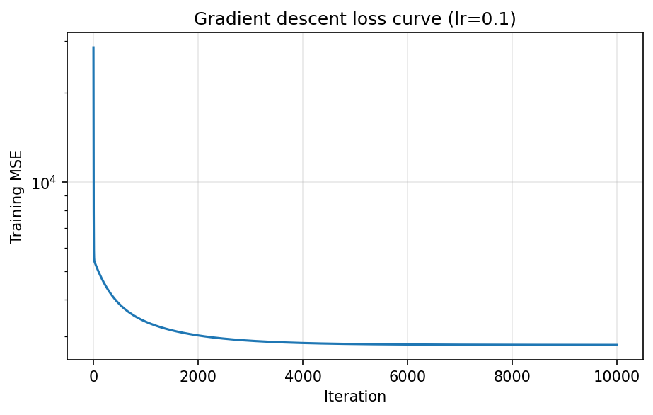

# Linear Regression from Scratch: Gradient Descent

A NumPy-only implementation of multiple linear regression trained with batch gradient descent, tested on the scikit-learn diabetes dataset.

## What this does

Instead of solving the normal equation in one step (see `../01-ols-from-scratch/`), gradient descent starts from an initial guess and repeatedly moves the weights and intercept in the direction that lowers the mean squared error (MSE).

## The math

Model and cost:

```
y_hat_i = w . x_i + b
J(w, b) = (1/n) * sum_i (y_i - y_hat_i)^2
```

Derivatives, using the chain rule:

```
dJ/dw_j = -(2/n) * sum_i (y_i - y_hat_i) * x_ij
dJ/db   = -(2/n) * sum_i (y_i - y_hat_i)
```

Update rule, repeated for `epoch` iterations:

```
w <- w - lr * dJ/dw
b <- b - lr * dJ/db
```

`lr` is the learning rate, which controls the step size.

## Implementation

`LinearRegressionGD(lr=0.01, epoch=1000)`

| Part | What it does |
|------|--------------|
| `fit(x, y)` | Initializes `coeff_` to ones and `intercept_` to 0, then runs `epoch` gradient steps |
| `predict(x)` | Returns `intercept_ + x @ coeff_` |
| `coeff_`, `intercept_` | Learned weights and bias |
| `loss_history_` | Training MSE recorded at every iteration |

In each iteration the predictions `y_hat` are computed once and used for both gradients, so the weights and the intercept are updated from the same point.

## Usage

```python
from sklearn.datasets import load_diabetes
from sklearn.model_selection import train_test_split
from sklearn.metrics import r2_score

x, y = load_diabetes(return_X_y=True, scaled=True)
x_train, x_test, y_train, y_test = train_test_split(
    x, y, test_size=0.2, random_state=11
)

model = LinearRegressionGD(lr=0.1, epoch=10000)
model.fit(x_train, y_train)
pred = model.predict(x_test)

print("R2 score: ", r2_score(y_test, pred))
```

## Experiment

- **Dataset:** scikit-learn diabetes (442 samples, 10 features)
- **Features:** `load_diabetes(scaled=True)`, the default scaling. Each column has a standard deviation of about 0.0476 (printed by `x.std(axis=0)`), so the features are small in scale but not unit variance.
- **Split:** 80% train / 20% test, `random_state=11`
- **Hyperparameters:** `lr=0.1`, `epoch=10000`

### Result

| Metric | Value |
|--------|-------|
| Test R² (gradient descent) | 0.5714 |
| Test R² (OLS, same split, from the OLS notebook) | 0.5772 |

The training loss starts at about 28,486 (with weights initialized to ones) and falls steeply in the first few iterations.

### Loss curve



The curve, drawn on a log scale, shows a steep initial drop followed by a long, slow decline. It flattens out after roughly 5,000 to 6,000 iterations, and it has no spikes, which means the learning rate of 0.1 is stable for this data.

## Observations

- The implementation works: the loss decreases smoothly and the model reaches a test R² close to the OLS result.
- Gradient descent scores slightly below OLS (0.5714 vs 0.5772). OLS gives the exact minimum of the training error, while gradient descent only approaches it, so a small gap is expected when the optimization has not fully converged.
- Most of the improvement happens in the first few hundred iterations. The remaining iterations change the loss very little.

## Limitations and next steps

- The number of epochs is fixed. A stopping rule based on a small change in loss would avoid wasted iterations.
- Convergence was judged by test R² and the loss curve only. A stronger check is to compare the learned `coeff_` and `intercept_` with `sklearn.linear_model.LinearRegression`.
- Features were not standardized with `StandardScaler`. Standardizing usually makes gradient descent converge faster and allows a wider range of learning rates.
- Only batch gradient descent is implemented. Stochastic and mini-batch versions come next.

## Files

```
02-gradient-descent-from-scratch/
├── linearRegressionGD.ipynb   # class, training, evaluation, loss plot
├── loss_curve.png             # saved from the notebook
└── README.md
```

## Run it

From the repository root, with the virtual environment active:

```bash
pip install -r requirements.txt
jupyter notebook 01-linear-regression/02-gradient-descent-from-scratch/linearRegressionGD.ipynb
```