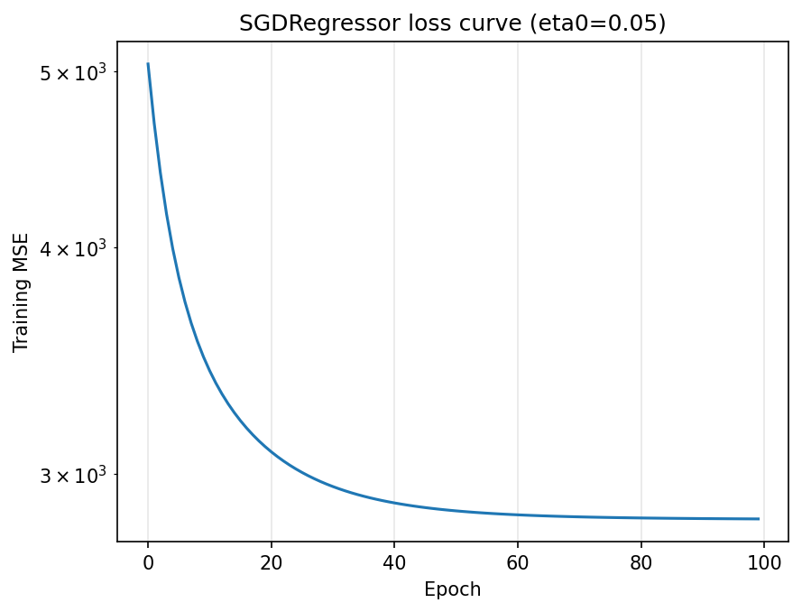

# Linear Regression with scikit-learn: OLS and Gradient Descent

The same regression problem solved with scikit-learn's ready-made models, compared with the from-scratch versions in the earlier folders.

| Notebook | Model | Method |
|----------|-------|--------|
| `sklearn_linear_regression_ols.ipynb` | `LinearRegression` | Exact least-squares solution |
| `sklearn_linear_regression_gd.ipynb` | `SGDRegressor` | Stochastic gradient descent |

## Setup (same for both notebooks)

- **Dataset:** scikit-learn diabetes (442 samples, 10 features), loaded with `load_diabetes(scaled=True)`
- **Split:** 80% train / 20% test, `random_state=11`, the same split as the from-scratch notebooks, so scores are comparable
- **Metrics:** R², MAE (mean absolute error), RMSE (root mean squared error), all on the test set

## 1. OLS with `LinearRegression`

```python
model = LinearRegression()
model.fit(x_train, y_train)
pred = model.predict(x_test)
```

| Metric | Value |
|--------|-------|
| R² | 0.5772 |
| MAE | 45.34 |
| RMSE | 56.68 |
| Intercept | 152.88 |

**Check against the from-scratch OLS:** my own normal-equation implementation gave R² = 0.5771689611166471 and MAE = 45.342351869703755 on the same split. scikit-learn gives 0.5771689611166474 and 45.34235186970372. The results agree to about 14 digits, which confirms the from-scratch implementation is correct.

## 2. Gradient descent with `SGDRegressor`

```python
model = SGDRegressor(penalty=None, random_state=0, learning_rate='constant',
                     eta0=0.05, tol=None, max_iter=80)
model.fit(x_train, y_train)
```

Settings:
- `penalty=None`: no regularization, so the model is plain linear regression like the others
- `learning_rate='constant'`, `eta0=0.05`: a fixed step size, like `lr` in the from-scratch class
- `tol=None`: always run all `max_iter` epochs instead of stopping early
- `max_iter=80`: number of epochs
- `random_state=0`: reproducible shuffling

| Metric | Value |
|--------|-------|
| R² | 0.5749 |
| MAE | 45.12 |
| RMSE | 56.83 |

`SGDRegressor` is stochastic gradient descent: it updates the weights after each single sample (batch size 1). scikit-learn has no batch or mini-batch gradient descent for linear regression. The from-scratch class in `../02-gradient-descent-from-scratch/` covers the batch version.

### Learning rate experiment

Constant learning rate, 1000 epochs, same split:

| `eta0` | Test R² | Largest coefficient gap vs OLS |
|-------:|--------:|-------------------------------:|
| 0.001 | 0.5424 | 463.6 |
| 0.01 | 0.5691 | 396.7 |
| 0.05 | 0.5739 | 312.6 |

A smaller learning rate gives a lower score here because 1000 epochs are not enough for the small steps to reach the solution. It does not mean the model is worse.

### Loss curve



The curve shows the training MSE after each epoch for `eta0=0.05`, on a log scale. The loss falls steeply in the first epochs and then flattens, so most of the training happens early.

## Comparison

| Model | R² | MAE | RMSE |
|-------|---:|----:|-----:|
| `LinearRegression` (OLS) | 0.5772 | 45.34 | 56.68 |
| `SGDRegressor` (eta0=0.05, 80 epochs) | 0.5749 | 45.12 | 56.83 |

The coefficients show a clear difference:

| | Coefficient 5 | Coefficient 6 |
|---|---:|---:|
| OLS | -449.7 | 217.8 |
| SGD | -41.1 | -135.8 |

The largest coefficient gap between the two models is about 408.6 (coefficient 5).

## Observations

- **SGD gets very close to OLS in prediction quality.** R² differs by 0.002, and the MAE is about the same. SGD's MAE is slightly lower on this test set, which should be read as noise, since OLS is by definition the best fit on the training data.
- **The coefficients are not the same, even though the predictions are.** Several features in this dataset are strongly correlated, so many different coefficient combinations produce almost the same predictions. SGD stops at a different point along that flat region than OLS does. Because of this, SGD's coefficients should not be interpreted as the true effect of each feature.
- **OLS is exact and instant on this small dataset.** Gradient descent needs a learning rate and an epoch count, and it only approximates the answer.
- **Gradient descent matters for what comes next.** For very large datasets, and for models with no closed-form solution such as neural networks, an iterative method like this is the tool.

## Limitations

- The number of epochs (80) was not chosen by cross-validation. With a constant learning rate, the test score changes from one epoch count to another, so small differences between SGD runs are not reliable.
- The features use scikit-learn's default scaling and are not standardized with `StandardScaler`. Standardizing would speed up convergence.
- Results come from one train/test split.

## Files

```
03-sklearn/
├── sklearn_linear_regression_ols.ipynb
├── sklearn_linear_regression_gd.ipynb
├── sgd_loss_curve.png
└── README.md
```

## Run it

From the repository root, with the virtual environment active:

```bash
pip install -r requirements.txt
jupyter notebook 01-linear-regression/03-sklearn/
```


